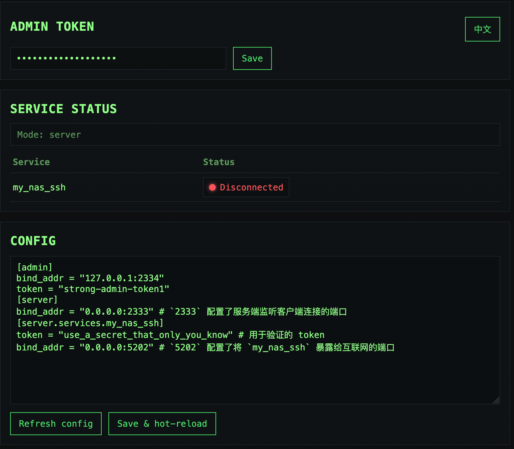

# Rathole Web

Rathole Web is a web-based control plane for Rathole,
providing management, monitoring, and configuration via browser.

This project extends Rathole core with minimal and well-scoped hooks,
while staying closely aligned with upstream development.

[English](README.md) | [简体中文](README-zh.md)

<!-- TOC -->

- [Rathole Web](#rathole-web)
  - [Relationship with Rathole Core](#relationship-with-rathole-core)
  - [Features](#features)
  - [Screenshot](#screenshot)
  - [Quickstart](#quickstart)
  - [Configuration](#configuration)

<!-- /TOC -->

## Relationship with Rathole Core

Rathole Web is not a fork intended to replace Rathole.

It introduces a small set of core extensions to expose runtime state and control hooks required by the web UI. All extensions are designed to be minimal, explicit, and isolated from Rathole’s core logic.

Upstream project: [rapiz1/rathole](https://github.com/rapiz1/rathole).

## Features

- **Web control plane** Browser UI to read/write configuration, trigger hot reload, and check service connectivity with token protection.
  
The following remain from upstream Rathole:
- **High Performance** Much higher throughput can be achieved than frp, and more stable when handling a large volume of connections. See [Benchmark](#benchmark)
- **Low Resource Consumption** Consumes much fewer memory than similar tools. See [Benchmark](#benchmark). [The binary can be](docs/build-guide.md) **as small as ~500KiB** to fit the constraints of devices, like embedded devices as routers.
- **Security** Tokens of services are mandatory and service-wise. The server and clients are responsible for their own configs. With the optional Noise Protocol, encryption can be configured at ease. No need to create a self-signed certificate! TLS is also supported.
- **Hot Reload** Services can be added or removed dynamically by hot-reloading the configuration file. HTTP API is WIP.

## Screenshot



## Quickstart

1. Build this fork:
   ```bash
   cargo build --release
   ```
2. Prepare your Rathole config as usual (see upstream docs), then add admin config:
   ```toml
   [admin]
   bind_addr = "127.0.0.1:2334"
   token = "strong-admin-token"
   ```
   You can also override via env vars: `RATHOLE_ADMIN_TOKEN`, `RATHOLE_ADMIN_BIND`.
3. Run:
   ```bash
   ./target/release/rathole config.toml
   ```
4. Open `http://<bind_addr>/` in a browser, enter the admin token, and you can view service connectivity and read/save config (saving triggers hot reload).

Without `[admin]` or admin env vars, it behaves like upstream Rathole (no web control plane). Upstream releases: [rapiz1/rathole](https://github.com/rapiz1/rathole/releases).

## Configuration

Admin config example:
```toml
[admin]
bind_addr = "127.0.0.1:2334"
token = "strong-admin-token"
```
Env overrides: `RATHOLE_ADMIN_TOKEN`, `RATHOLE_ADMIN_BIND`.

Server/Client config stays the same as upstream; see upstream docs or this repo’s `examples/` and `docs/transport.md`.

### Security behaviour

- **Admin UI secrets.** `GET /api/config` returns every `token`, `default_token`, `local_private_key` and `pkcs12_password` as `"<redacted>"`. Leave a value as `"<redacted>"` when saving to keep the secret on disk, or type a new value to replace it. If a secret is written in a form the UI can't redact (an inline table, a multi-line string), the UI refuses to show the config; put each secret on its own `key = "value"` line.
- **Admin UI hardening.** Responses carry a strict Content-Security-Policy, `X-Frame-Options: DENY` and `Cache-Control: no-store`. The browser keeps the token in `sessionStorage`, so it's gone when the tab closes. After 5 bad tokens in a minute, a source gets `429` for 5 minutes. The UI is plain HTTP and logs a warning when bound to a non-loopback address; keep it on 127.0.0.1 and reach it through an SSH tunnel or a TLS proxy.
- **Handshake throttle.** After `auth_fail_limit` failed handshakes in a minute (default 10; 0 turns it off), the server drops new connections from that source for `auth_ban_secs` (default 300) before any transport handshake. An IPv6 source counts per /64. A successful login clears the count. Note that a misconfigured client also locks out correct clients sharing its address.
  ```toml
  [server]
  auth_fail_limit = 10
  auth_ban_secs = 300
  ```
- **No service enumeration.** An unknown service name gets the same `AuthFailed` reply as a wrong token, so a client sees "Incorrect token" in both cases; the server log says which.
- **Handshake deadline.** A connection that doesn't send its hello or auth within 10 seconds is closed.

Example config (admin + one service):
```toml
[admin]
bind_addr = "127.0.0.1:2334"
token = "strong-admin-token"

[server]
bind_addr = "0.0.0.0:2333"

[server.services.my_nas_ssh]
token = "use_a_secret_that_only_you_know"
bind_addr = "0.0.0.0:5202"
```
